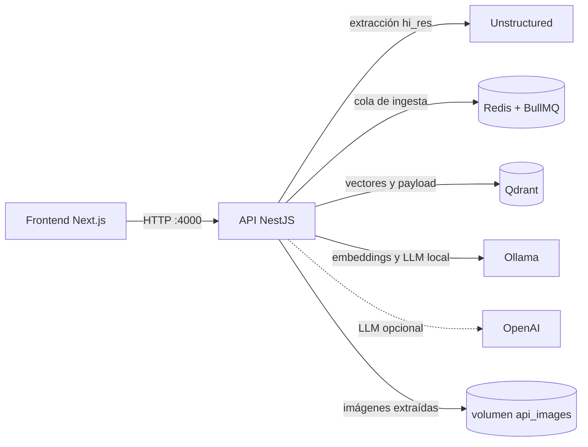
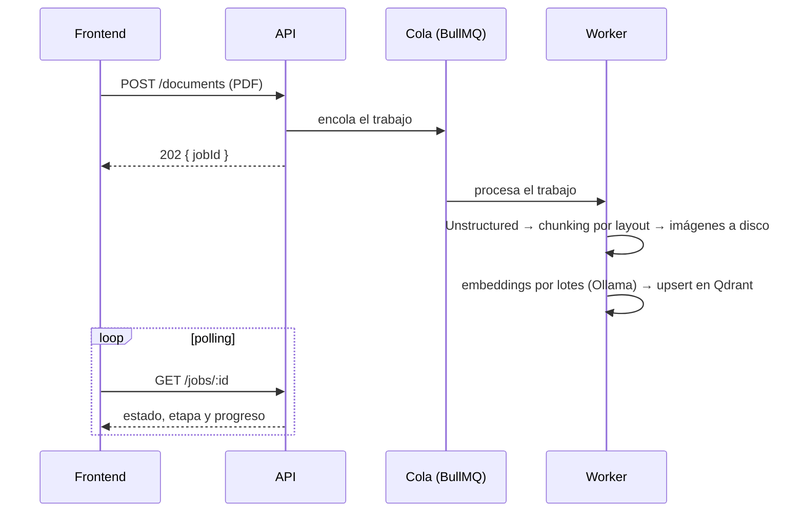
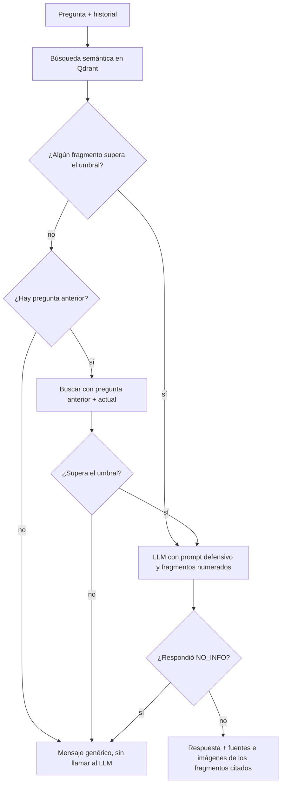

# Sistema RAG multimodal

> Desarrollado con **Claude Code**.

API para hacer preguntas sobre documentos PDF. El usuario sube sus documentos, el sistema los procesa en segundo plano (extrae texto, tablas e imágenes respetando el layout de cada página) y luego responde preguntas en un chat usando solo esos documentos como contexto. Cada respuesta incluye el texto, las fuentes (documento y página) y las imágenes relacionadas.

Para no gastar tokens en preguntas ajenas a los documentos, la búsqueda aplica un umbral mínimo de similitud: si nada lo supera, la API responde un mensaje genérico sin llamar al LLM. Si la pregunta pasa el umbral pero el contexto no tiene la respuesta, un prompt defensivo hace que el LLM lo indique en lugar de inventar.

El LLM se elige en cada pregunta entre los proveedores configurados: Ollama (local y gratuito, disponible siempre) y OpenAI (si hay API key). Todo corre en contenedores con Docker Compose.

## Arquitectura



### Ingesta de un documento



### Respuesta del chat



### Módulos de la API

| Módulo | Responsabilidad |
|--------|-----------------|
| `llm` | Registro de modelos por proveedor; `GET /models`. Un cliente compatible con la API de OpenAI cubre Ollama y OpenAI. |
| `embeddings` | Modelo de embeddings fijo al arrancar, con catálogo de dimensión, prefijos, límite de entrada y umbral. |
| `vector-store` | Qdrant detrás de una interfaz; colección creada al primer uso. |
| `documents` | Subida, cola de ingesta, extracción con Unstructured, chunking por layout, imágenes y `GET /health`. |
| `retrieval` | Búsqueda semántica con umbral mínimo y tope de contexto. |
| `chat` | `POST /chat`: historial, prompt defensivo, citas, fuentes e imágenes. |

La arquitectura es en capas (controlador, servicio y providers por módulo) y las integraciones externas están detrás de interfaces.

## Requisitos

- **Docker** con Docker Compose.
- **Espacio en disco: unos 40 GB.** La imagen de Unstructured ocupa unos 32 GB y los modelos de Ollama (`llama3.2` y `nomic-embed-text`) unos 2,3 GB.
- **Memoria.** Unstructured ocupa entre 0,7 y 1,3 GB en reposo y más al procesar un documento; `llama3.2` ocupa unos 2,6 GB al responder. Para ejecutar todo a la vez, Docker necesita unos 6 GB. En Windows, Docker Desktop con WSL 2 usa por defecto la mitad de la RAM del equipo, así que conviene un equipo de 16 GB. En equipos con menos memoria, usa OpenAI para el chat (ver [Configuración](#configuración)).

> **Nota:** en el equipo de desarrollo (7,8 GB de RAM) no se pudo probar de forma fiable el chat con Ollama, probablemente por falta de memoria. El chat se probó con OpenAI (`gpt-4o-mini`).

## Cómo levantarlo

1. Clona el repositorio y entra en la carpeta:

   ```bash
   git clone <url-del-repositorio>
   cd prueba_tecnica_lf
   ```

2. Crea el archivo `.env` a partir de la plantilla. Funciona vacío; solo hace falta completarlo para usar OpenAI:

   ```bash
   cp .env.example .env
   ```

3. Levanta los servicios:

   ```bash
   docker compose up -d --build
   ```

   La primera vez descarga la imagen de Unstructured (unos 32 GB) y el servicio `ollama-init` descarga los modelos de Ollama, lo que puede tardar bastante según la conexión. Para descargar las imágenes por adelantado: `docker compose pull`.

4. Espera a que el sistema esté listo. `GET /health` responde `200` cuando Qdrant, Redis, Unstructured y el modelo de embeddings están disponibles; mientras tanto responde `503` con el detalle de cada servicio:

   ```bash
   curl http://localhost:4000/health
   ```

5. Consulta los modelos disponibles para el chat:

   ```bash
   curl http://localhost:4000/models
   # ["ollama:llama3.2","openai:gpt-4o-mini"]
   ```

Para detener el sistema sin perder los documentos indexados usa `docker compose stop` y `docker compose start`. `docker compose down` elimina los contenedores y con ellos los datos de Qdrant y Redis (los modelos de Ollama y las imágenes extraídas se conservan en volúmenes).

## Uso de la API

La API escucha en `http://localhost:4000` y acepta CORS desde `http://localhost:3000`.

| Método | Ruta | Descripción |
|--------|------|-------------|
| `GET` | `/health` | Estado de las dependencias; `503` si alguna no está lista. |
| `GET` | `/models` | Modelos disponibles para el chat. |
| `POST` | `/documents` | Sube un PDF (campo `file`, hasta 20 MB). Responde `202` con el `jobId`. |
| `GET` | `/jobs/:id` | Estado del procesamiento: `pending`, `processing`, `completed` o `failed`, con etapa y progreso. |
| `GET` | `/documents` | Todos los documentos subidos con su estado. |
| `POST` | `/chat` | Pregunta sobre los documentos. |
| `GET` | `/images/:documentId/:archivo` | Imagen extraída de un documento. |

### Subir un documento y seguir su procesamiento

```bash
curl -F "file=@manual.pdf;type=application/pdf" http://localhost:4000/documents
# {"jobId":"7b287d35-..."}

curl http://localhost:4000/jobs/7b287d35-...
# {"id":"7b287d35-...","documentName":"manual.pdf","status":"processing","stage":"embedding","progress":45,...}
```

Un archivo que no es PDF responde `400`; uno de más de 20 MB, `413`; si el sistema no está listo, `503`.

### Preguntar

```bash
curl -X POST http://localhost:4000/chat \
  -H "Content-Type: application/json" \
  -d '{
    "model": "openai:gpt-4o-mini",
    "message": "¿Cómo quedó el corte láser con condensador?",
    "history": []
  }'
```

```json
{
  "answer": "El corte láser con condensador produjo resultados más satisfactorios, ya que el derretimiento de resina fue nulo y se logró un corte fino con una cara negra similar al acabado del MDF [2].",
  "sources": [{ "documentId": "8e3a98a9-...", "documentName": "prueba_rag_2.pdf", "page": 8 }],
  "images": ["/images/8e3a98a9-.../p8-3.jpg"]
}
```

- `model` es opcional (por defecto, Ollama); `message` admite hasta 1000 caracteres.
- `history` lo mantiene el frontend: lista de `{ "role": "user" | "assistant", "content": "..." }`. Se usan los últimos 6 mensajes.
- Si la respuesta no está en los documentos, `answer` es "No encontré información sobre eso en los documentos cargados." y `sources` e `images` vienen vacíos.

## Configuración

Variables del archivo `.env` (todas opcionales; dentro de Docker Compose, las URL de los servicios las define el propio `docker-compose.yml`):

| Variable | Por defecto | Descripción |
|----------|-------------|-------------|
| `OLLAMA_LLM_MODEL` | `llama3.2` | Modelo de chat en Ollama. |
| `OPENAI_API_KEY` | — | Activa OpenAI como proveedor del chat. |
| `OPENAI_MODEL` | — | Modelo de OpenAI, por ejemplo `gpt-4o-mini`. Se necesita junto con la key. |
| `EMBEDDING_BACKEND` | `ollama` | `ollama` u `openai`. Se elige al arrancar; cambiarlo exige reindexar. |
| `OLLAMA_EMBEDDING_MODEL` | `nomic-embed-text` | Modelo de embeddings en Ollama. Debe estar en el catálogo. |
| `OPENAI_EMBEDDING_MODEL` | `text-embedding-3-small` | Modelo de embeddings en OpenAI. |
| `QDRANT_COLLECTION` | `documents` | Colección de Qdrant. |

Para usar OpenAI en el chat, completa `OPENAI_API_KEY` y `OPENAI_MODEL` y recrea la API para que lea el `.env`:

```bash
docker compose up -d --force-recreate api
```

## Frontend

El frontend, en Next.js, está pensado como una sola pantalla con tres secciones, sin websockets ni streaming:

1. **Modelo.** Un selector con las opciones de `GET /models`, con Ollama preseleccionado. El modelo elegido se envía en cada pregunta, así que puede cambiarse en cualquier momento de la conversación.
2. **Documentos.** Una zona para subir PDF, deshabilitada mientras `GET /health` no responda `200`. Cada subida devuelve un `jobId` que se consulta por polling en `GET /jobs/:id` para mostrar la etapa y el progreso (extracción, chunking, embeddings, indexación). La lista de documentos sale de `GET /documents`, así que se conserva al recargar la página.
3. **Chat.** Deshabilitado hasta que haya al menos un documento en estado `completed`. El historial vive en el navegador y se envía completo en cada `POST /chat`. Mientras llega la respuesta se muestra un indicador de "pensando" y se bloquea el campo de texto; al llegar, el mensaje del asistente muestra el texto en Markdown con sus citas `[n]`, las fuentes como etiquetas "documento · pág. N" y las imágenes como miniaturas que se amplían al hacer clic.

## Limitaciones conocidas

- **Chunking.** El texto a dos columnas puede quedar mezclado en un mismo chunk; las tablas que continúan en otra página pierden sus encabezados; los subtítulos en cursiva no abren sección; las ecuaciones se aplanan. En algunas preguntas, la respuesta no llega al contexto del LLM. Ver [ADR-0014](docs/adr/0014-chunking-por-layout.md).
- **Umbral de similitud.** Filtra lo claramente ajeno a los documentos, pero las preguntas del mismo tema que los documentos no responden lo superan y dependen del prompt defensivo. El valor (0.61) está calibrado para `nomic-embed-text` con dos documentos. Ver [ADR-0018](docs/adr/0018-busqueda-semantica-con-umbral.md).
- **Imágenes.** Una imagen se encuentra por su pie de figura, su texto de OCR o el texto cercano, no por lo que muestra.
- **Modelo local.** `llama3.2` es pequeño: tiende a responder que no tiene información aunque el dato esté en el contexto, rara vez cita los fragmentos y no siempre responde en el idioma de la pregunta. Ver [ADR-0020](docs/adr/0020-prompt-defensivo.md).
- **Datos efímeros.** Qdrant y Redis no persisten al eliminar los contenedores; está pensado como entorno de desarrollo y demostración.

## Decisiones de arquitectura

Cada decisión quedó registrada en un ADR en [`docs/adr`](docs/adr/README.md), con su contexto, las alternativas consideradas, sus consecuencias y los problemas encontrados en las pruebas.

## Pendiente

- Frontend en Next.js.
- Reintentos ante fallos transitorios (Unstructured, embeddings, Qdrant y LLM).
- Mantener cargado y precargar el modelo de Ollama para que la primera pregunta no espere la carga.
